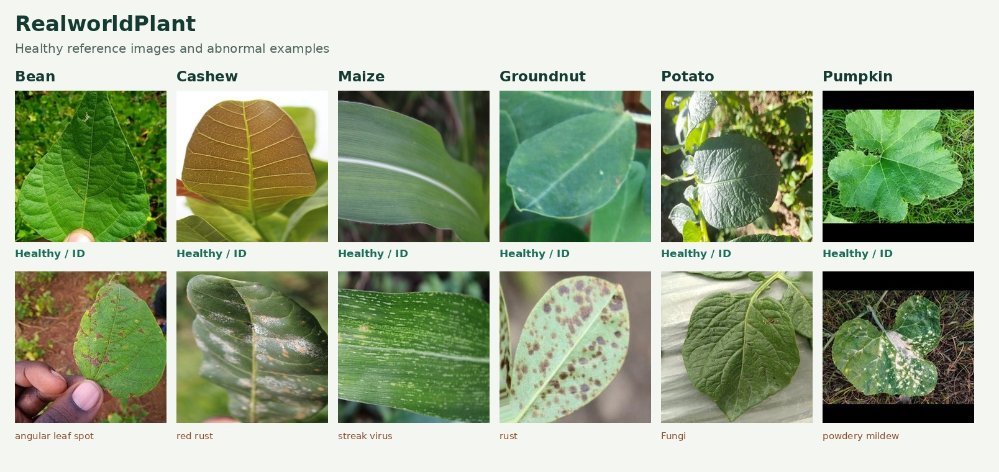
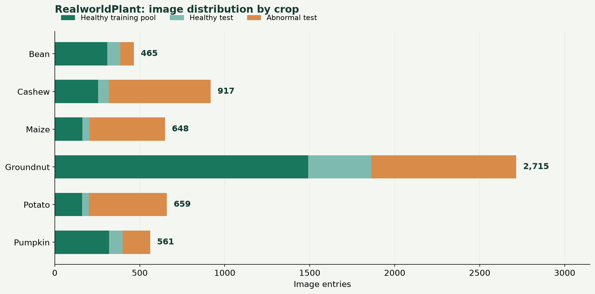

# RealworldPlant

**A curated multi-crop leaf image dataset for healthy-reference anomaly detection.**

[6 crops](#3-dataset-statistics) · [16 abnormal categories](#4-abnormal-categories) · [5,965 image entries](#3-dataset-statistics) · [Download](#7-download-and-use) · [Companion dataset](https://github.com/jsjnrxx2001/LabVirtualPlant)



*Figure 1. Representative samples from RealworldPlant. Each column shows one crop: a healthy leaf above and an abnormal leaf below. Category labels are inherited from the released dataset.*

## 1. Keywords

Plant leaf images; multi-crop dataset; anomaly detection; out-of-distribution detection; healthy reference samples; few-shot evaluation.

## 2. Dataset description and construction

RealworldPlant is a curated image collection for studying plant leaf anomaly detection with healthy reference samples. It covers bean, cashew, maize, groundnut, potato, pumpkin, with **6 healthy crop categories** and **16 abnormal categories**. Images were selected and reorganized from public plant-image resources, with source links listed below.

The scene grouping is based on **the visual cleanliness of the image background**. This collection emphasizes natural backgrounds, including surrounding vegetation, soil, and hand-held leaves. Its companion [LabVirtualPlant](https://github.com/jsjnrxx2001/LabVirtualPlant) supports evaluation under the complementary background condition. These names describe the curated image appearance rather than a standardized capture device or acquisition location.

The construction procedure organizes images by crop and original health-condition label, assigns healthy crop categories integer ID labels, and places selected non-healthy conditions in the OOD evaluation pool. Abnormal conditions include disease symptoms and, where present, insect damage, dry leaves, or nutrient-related abnormalities. Representative images in the current release are 256 × 256 RGB images.

The dataset provides a healthy training pool and an evaluation set containing both healthy and abnormal images. In a few-shot setting, the training pool supplies healthy references; the anomaly-detection task is to distinguish these healthy ID samples from abnormal OOD samples.

## 3. Dataset statistics

| Item | Number |
|---|---:|
| Healthy crop categories | 6 |
| Abnormal categories | 16 |
| Healthy training-pool images | 2,696 |
| Healthy test images | 674 |
| Abnormal test images | 2,595 |
| Combined test images | 3,269 |
| Total image entries | 5,965 |



*Figure 2. Image counts by crop and evaluation role, computed from the released JSON manifests. The healthy holdout is counted once.*

| Crop | Healthy train | Healthy test | Abnormal test | Abnormal categories |
|---|---:|---:|---:|---:|
| Bean | 308 | 77 | 80 | 2 |
| Cashew | 254 | 64 | 599 | 2 |
| Maize | 163 | 41 | 444 | 2 |
| Groundnut | 1,490 | 372 | 853 | 4 |
| Potato | 161 | 40 | 458 | 2 |
| Pumpkin | 320 | 80 | 161 | 4 |

## 4. Abnormal categories


*Figure 3. One released image from every abnormal category. These examples illustrate the repository labels; they are not additional diagnostic annotations. Figure-to-image mappings are recorded in [sample_manifest.json](assets/sample_manifest.json).*

<details>
<summary>Expand the complete abnormal-category inventory</summary>

| Category folder | Images |
|---|---:|
| `Bean_angular_leaf_spot` | 40 |
| `Bean_rust` | 40 |
| `Cashew_leaf_miner` | 231 |
| `Cashew_red_rust` | 368 |
| `Groundnut_early_leaf_spot` | 174 |
| `Groundnut_late_leaf_spot` | 191 |
| `Groundnut_nutrition_deficiency` | 167 |
| `Groundnut_rust` | 321 |
| `Maize_leaf_blight` | 219 |
| `Maize_streak_virus` | 225 |
| `Patato_Fungi` | 390 |
| `Patato_Nematode` | 68 |
| `Pumpkin_bacterial_leaf_spot` | 40 |
| `Pumpkin_downy_mildew` | 40 |
| `Pumpkin_mosaic_disease` | 40 |
| `Pumpkin_powdery_mildew` | 41 |

</details>

## 5. Data partition and label format

Healthy images are split **within each crop category** into approximately 80% training-pool samples and 20% held-out samples, using random seed **1**. The per-class holdout size is `round(0.2 * class_size)`. The selected abnormal images are assigned to OOD evaluation.

| File | Contents |
|---|---|
| `train.json` | Relative image paths mapped to integer healthy-class labels |
| `test.json` | Healthy holdout paths mapped to the same integer labels |
| `ood.json` | Abnormal image paths mapped to the string `"ood"` |
| `classnames.txt` | Healthy-class names and text descriptions |
| `summary.json` | Construction-time summary; its absolute paths describe the original preparation machine |
| `split_fewshot.bak/` | Existing healthy-reference selections for different shots and seeds |

Healthy test images are stored under `test/` and indexed by `test.json`. This release contains a healthy training pool, a healthy test set, and an abnormal test set. No separate validation set is provided. Few-shot files use seeds **1, 2, and 3**, with **2, 4, 8, and 16** samples per healthy category; files named with `shot_4096` represent the full training pool, capped by the available class size.

Original directory spellings are retained for compatibility with the manifests. In particular, `Batol_Gourd` denotes bottle gourd, `Corn`/`Maize` refer to maize, and `Patato` in some abnormal folders denotes potato. Use the released paths verbatim when loading files.

## 6. Repository structure

```text
RealworldPlant/
├── README.md
├── assets/                    # Documentation figures and image mappings
├── train/<crop>_healthy/      # Healthy training images
├── test/<crop>_healthy/       # Healthy test images
├── ood_<crop>/<condition>/    # Abnormal evaluation images
├── train.json
├── test.json
├── ood.json
├── classnames.txt
├── summary.json
└── split_fewshot.bak/
```

## 7. Download and use

Clone the image repository:

```bash
git clone https://github.com/jsjnrxx2001/RealworldPlant.git
```

Alternatively, select **Code → Download ZIP** on GitHub. The image folders are part of this repository.

The JSON files can be read with standard Python. The following example loads one healthy reference image using Pillow (`pip install pillow`):

```python
import json
from pathlib import Path
from PIL import Image

root = Path("RealworldPlant")
with (root / "train.json").open(encoding="utf-8") as f:
    train = json.load(f)

relative_path, class_id = next(iter(train.items()))
image = Image.open(root / relative_path).convert("RGB")
print(relative_path, class_id, image.size)

with (root / "ood.json").open(encoding="utf-8") as f:
    abnormal = json.load(f)
print("Healthy references:", len(train))
print("Abnormal evaluation images:", len(abnormal))
```

## 8. Image sources and acknowledgments

This dataset was constructed by curating and reorganizing subsets of public leaf-image resources. Source attribution is recorded by crop and condition below. Background appearance was used to organize the curated scene collection; images from a parent dataset may therefore contribute to either scene collection.

| Released crop | Upstream source | Included subset |
|---|---|---|
| Bean | [S5](https://github.com/AI-Lab-Makerere/ibean/) | Healthy, angular leaf spot, and bean rust; sample content matches establish the upstream image resource. |
| Cashew | [S2](https://data.mendeley.com/datasets/z6jp232g5j/1) | Healthy, leaf miner, and red rust subsets. |
| Maize | [S2](https://data.mendeley.com/datasets/z6jp232g5j/1) | Maize healthy, maize leaf blight, and maize streak virus subsets. |
| Groundnut | [S6](https://data.mendeley.com/datasets/22p2vcbxfk/3) | Healthy, early leaf spot, late leaf spot, nutrition deficiency, and rust. The released rust group contains examples matching both original `rust_1` and `early_rust_1`. |
| Potato | [S2](https://data.mendeley.com/datasets/z6jp232g5j/1) | Healthy, Fungi, and Nematode subsets; released abnormal paths retain the spelling `Patato`. |
| Pumpkin | [P1](https://data.mendeley.com/datasets/wtxcw8wpxb/2) (candidate only) | The five class names match the candidate dataset. Image-content matching has not been completed; provenance remains pending. |

See [SOURCES.md](SOURCES.md) for original folder mappings, authors, dataset versions, DOI links, license references, and attribution details. [class_sources.csv](class_sources.csv) provides class-level source IDs; [source_examples.csv](source_examples.csv) records the checked image examples. These examples support subset attribution and do not constitute a complete per-image provenance manifest.

## 9. Citation

Please cite this dataset repository and the original image sources relevant to your work. A repository citation can be recorded as:

```bibtex
@misc{realworldplant_dataset,
  title = {RealworldPlant},
  howpublished = {\url{https://github.com/jsjnrxx2001/RealworldPlant}},
  year = {2026},
  note = {Curated plant leaf anomaly detection dataset}
}
```

For reproducible experiments, also record the commit used to obtain the images and split files.

## 10. License and usage

Original images remain subject to the licenses, terms of use, attribution requirements, and citation requirements of their respective providers. The source references above should be consulted before reuse or redistribution. This README does not replace those upstream terms or assign a single new license to all images.

Questions about this collection can be raised through [GitHub Issues](https://github.com/jsjnrxx2001/RealworldPlant/issues).
