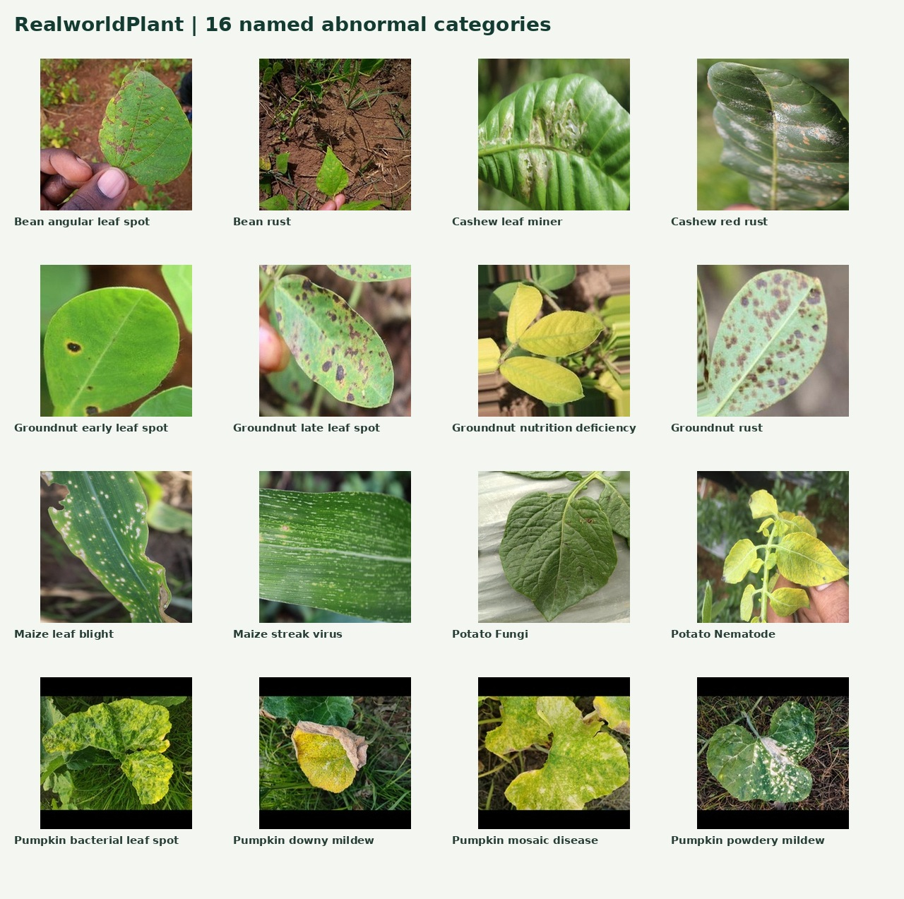

# RealworldPlant

**A curated multi-crop leaf image dataset for healthy-reference anomaly detection.**

[6 crops](#3-dataset-statistics) · [16 named abnormal categories](#4-abnormal-categories) · [5,955 image entries](#3-dataset-statistics) · [Download](#7-download-and-use) · [Companion dataset](https://github.com/jsjnrxx2001/LabVirtualPlant)


*Figure 1. Representative samples from RealworldPlant. Each column shows one crop: a healthy leaf above and an abnormal leaf below. Category labels are inherited from the released dataset.*

## 1. Keywords

Plant leaf images; multi-crop dataset; anomaly detection; out-of-distribution detection; healthy reference samples; few-shot evaluation.

## 2. Dataset description and construction

RealworldPlant is a curated image collection for studying plant leaf anomaly detection with healthy reference samples. It covers bean, cashew, maize, groundnut, potato, pumpkin, with **6 healthy crop categories** and **16 named abnormal categories**. Images were selected and reorganized from public plant-image resources, with source links listed below.

The scene grouping is based on **the visual cleanliness of the image background**. This collection emphasizes natural backgrounds, including surrounding vegetation, soil, and hand-held leaves. Its companion [LabVirtualPlant](https://github.com/jsjnrxx2001/LabVirtualPlant) supports evaluation under the complementary background condition. These names describe the curated image appearance rather than a standardized capture device or acquisition location.

The construction procedure organizes images by crop and original health-condition label, assigns healthy crop categories integer ID labels, and places selected non-healthy conditions in the OOD evaluation pool. Abnormal conditions include disease symptoms and, where present, insect damage, dry leaves, or nutrient-related abnormalities. Representative images in the current release are 256 × 256 RGB images.

The dataset provides a healthy training pool and an evaluation set containing both healthy and abnormal images. In a few-shot setting, the training pool supplies healthy references; the anomaly-detection task is to distinguish these healthy ID samples from abnormal OOD samples.

## 3. Dataset statistics

| Item | Number |
|---|---:|
| Healthy crop categories | 6 |
| Named abnormal categories | 16 |
| Abnormal test images with pending subtype | 4 |
| Healthy training-pool images | 2,695 |
| Healthy test images | 674 |
| Abnormal test images | 2,586 |
| Combined test images | 3,260 |
| Total image entries | 5,955 |


*Figure 2. Image counts by crop and evaluation role, computed from the released JSON manifests. Abnormal test counts include images with a pending subtype.*

| Crop | Healthy train | Healthy test | Abnormal test | Named abnormal categories | Pending subtype |
|---|---:|---:|---:|---:|---:|
| Bean | 308 | 77 | 80 | 2 | 0 |
| Cashew | 254 | 64 | 598 | 2 | 0 |
| Maize | 163 | 41 | 440 | 2 | 4 |
| Groundnut | 1,490 | 372 | 853 | 4 | 0 |
| Potato | 160 | 40 | 454 | 2 | 0 |
| Pumpkin | 320 | 80 | 161 | 4 | 0 |

## 4. Abnormal categories



*Figure 3. One released image from each named abnormal category, shown with its repository label. Figure-to-image mappings are recorded in [sample_manifest.json](assets/sample_manifest.json).*

<details>
<summary>Expand the named abnormal-category inventory</summary>

| Category folder | Images |
|---|---:|
| `Bean_angular_leaf_spot` | 40 |
| `Bean_rust` | 40 |
| `Cashew_leaf_miner` | 231 |
| `Cashew_red_rust` | 367 |
| `Groundnut_early_leaf_spot` | 174 |
| `Groundnut_late_leaf_spot` | 191 |
| `Groundnut_nutrition_deficiency` | 167 |
| `Groundnut_rust` | 321 |
| `Maize_leaf_blight` | 215 |
| `Maize_streak_virus` | 221 |
| `Patato_Fungi` | 386 |
| `Patato_Nematode` | 68 |
| `Pumpkin_bacterial_leaf_spot` | 40 |
| `Pumpkin_downy_mildew` | 40 |
| `Pumpkin_mosaic_disease` | 40 |
| `Pumpkin_powdery_mildew` | 41 |

</details>

The abnormal test split includes **4** images with conflicting subtype labels. These images have the binary label `"ood"`, are stored under `*_Subtype_Pending/`, and contribute to binary anomaly evaluation. The named category inventory counts only images assigned to a named subtype. [ood_subtype_pending.json](ood_subtype_pending.json) records candidate labels and original relative paths for these images.

## 5. Data partition and label format

The original split used random seed **1** to hold out approximately 20% of healthy images within each crop. The current release preserves the original split assignments of the retained samples. The released manifests define the exact partitions used in evaluation.

| File | Contents |
|---|---|
| `train.json` | Relative image paths mapped to integer healthy-class labels |
| `test.json` | Healthy holdout paths mapped to the same integer labels |
| `ood.json` | Abnormal image paths mapped to the string `"ood"` |
| `ood_subtype_pending.json` | Candidate subtype labels and provenance for images with conflicting subtype labels |
| `classnames.txt` | Healthy-class names and text descriptions |
| `summary.json` | Current split counts, category counts, and healthy-class label mapping |
| `split_fewshot.bak/` | Existing healthy-reference selections for different shots and seeds |

Healthy test images are stored under `test/` and indexed by `test.json`. This release contains a healthy training pool, a healthy test set, and an abnormal test set. No separate validation set is provided. Few-shot files use seeds **1, 2, and 3**, with up to **2, 4, 8, and 16** samples per healthy category. Categories with fewer than the requested number use all available healthy training images. Files named with `shot_4096` represent the full training pool.

### Dataset cleanup

For one exact-duplicate group spanning healthy train and test, the test copy was retained. Exact duplicate file contents within a split were reduced to one image per group. A SHA-256 check found no exact duplicates across this repository's three splits or within any split. The companion datasets share 55 identical cashew image files. Account for that overlap when combining the datasets or using one to evaluate references from the other.

Original directory spellings are retained for compatibility with the manifests. In particular, `Batol_Gourd` denotes bottle gourd, `Corn`/`Maize` refer to maize, and `Patato` in some abnormal folders denotes potato. Use the released paths verbatim when loading files.

## 6. Repository structure

```text
RealworldPlant/
├── README.md
├── assets/                    # Documentation figures and image mappings
├── train/<crop>_healthy/      # Healthy training images
├── test/<crop>_healthy/       # Healthy test images
├── ood_<crop>/<condition>/    # Abnormal evaluation images
├── train.json
├── test.json
├── ood.json
├── ood_subtype_pending.json
├── classnames.txt
├── summary.json
└── split_fewshot.bak/
```

## 7. Download and use

Clone the image repository:

```bash
git clone https://github.com/jsjnrxx2001/RealworldPlant.git
```

Alternatively, select **Code → Download ZIP** on GitHub. The image folders are part of this repository.

The JSON files can be read with standard Python. The following example loads one healthy reference image using Pillow (`pip install pillow`):

```python
import json
from pathlib import Path
from PIL import Image

root = Path("RealworldPlant")
with (root / "train.json").open(encoding="utf-8") as f:
    train = json.load(f)

relative_path, class_id = next(iter(train.items()))
image = Image.open(root / relative_path).convert("RGB")
print(relative_path, class_id, image.size)

with (root / "ood.json").open(encoding="utf-8") as f:
    abnormal = json.load(f)
print("Healthy references:", len(train))
print("Abnormal evaluation images:", len(abnormal))
```

## 8. Image sources and acknowledgments

We acknowledge the providers of the original image collections. The links below document the source resources identified for the corresponding subsets; they do not imply that every image in each original dataset is included here.

- [Multi-Crop Leaf Disease Dataset: Corn, Potato, Rice, Tomato, and Cashew](https://data.mendeley.com/datasets/z6jp232g5j/1) — Cashew, maize, and potato.
- [iBean — Makerere AI Lab](https://github.com/AI-Lab-Makerere/ibean/) — Bean subsets.
- [Groundnut Plant Leaf Images for Classification and Detection](https://data.mendeley.com/datasets/22p2vcbxfk/3) — Groundnut subsets.

Source attribution for the pumpkin subset is being finalized; a verified original-source link will be added when available.

## 9. Citation

Please cite this dataset repository and the original image sources relevant to your work. A repository citation can be recorded as:

```bibtex
@misc{realworldplant_dataset,
  title = {RealworldPlant},
  howpublished = {\url{https://github.com/jsjnrxx2001/RealworldPlant}},
  year = {2026},
  note = {Curated plant leaf anomaly detection dataset}
}
```

For reproducible experiments, also record the commit used to obtain the images and split files.

## 10. License and usage

Original images remain subject to the licenses, terms of use, attribution requirements, and citation requirements of their respective providers. The source references above should be consulted before reuse or redistribution. This README does not replace those upstream terms or assign a single new license to all images.

Questions about this collection can be raised through [GitHub Issues](https://github.com/jsjnrxx2001/RealworldPlant/issues).
